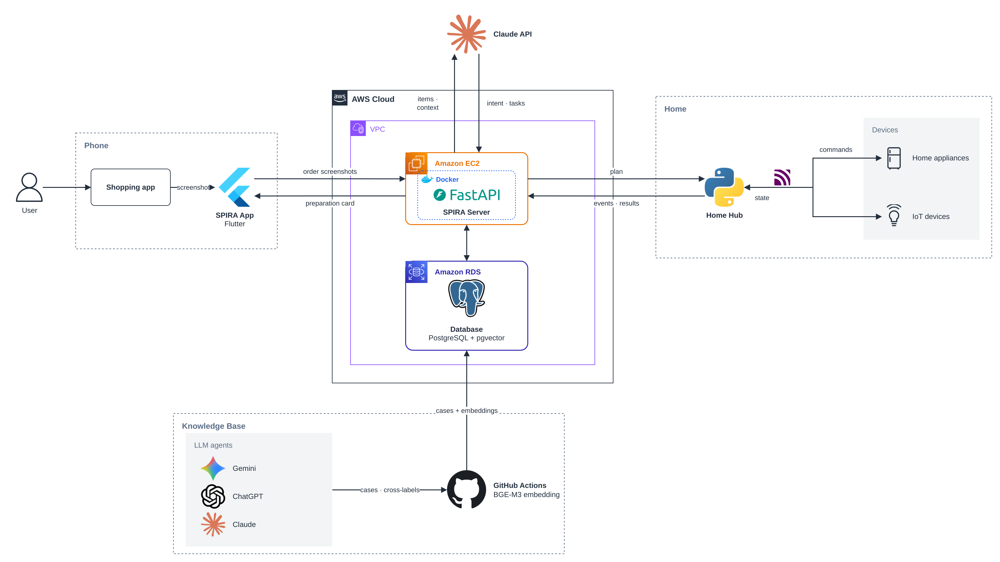

# 🏠 SPIRA

**Your order arrives. Your home is already prepared.**

> 26-2 Hanyang University · Software Engineering & AI and Applications Project

<!-- TODO: hero image -->

 

## 💡 Proposal

Online delivery brings products to the door, but the user still has to prepare the home for **what those products are for**.

**SPIRA** reads an order screenshot, finds similar cases in a **synthetic purchase-intent knowledge base**, and judges the purpose of the order.
If there is one, SPIRA prepares the home with appliances and IoT devices **without asking**, and tells the user once with a single card.

An order can point to a gathering, a trip, a new pet, a seasonal change, and more. SPIRA matches the preparation to the situation and to the devices each home has — a care tip on the fridge screen when a package comes in, cleaning or a safety mode before guests arrive, or an appliance set to standby for when it is needed.

### Core Ideas

**1. Synthetic purchase-intent knowledge**
- Real purchase records are scarce before launch, so LLM agents generate order cases from 30 intents.
- Two models from different companies label each order blindly; only batches that pass a quality gate are loaded.
- Most orders are ordinary shopping — *no intent, no tasks* is a normal result.

**2. Prepare without asking, within safe bounds**
- The home acts only at two moments: **the time of the event** and **when a package is brought in**.
- The LLM judges the intent and proposes tasks; code finds the time and limits tasks to this home's devices.
- Costly, dangerous, or irreversible actions (e.g. starting the oven) become a standby that a person starts.

**3. User reactions shape the next preparation**
- The user can stop a preparation or switch off a single line on the card.
- The Home Hub reads back real device state and never overwrites what a person changed.
- Stops, switched-off lines, and manual changes are kept as household memory for the next time.

 

## 📄 Documentation

*SPIRA: Proactively Preparing Smart Homes via Retrieval-Augmented Purchase Intent Inference over Synthetic Knowledge*

| Course | Documents |
| --- | --- |
| Software Engineering (CSE406) | [Paper (PDF)](https://github.com/CSE-SPIRA/SPIRA/blob/main/document/main.pdf) · [LaTeX Source](https://github.com/CSE-SPIRA/SPIRA/blob/main/document/main.tex) |
| AI & Applications (ITE351) | Paper — coming soon |

 

## 🔧 Architecture Design

  

| Part | Role | Stack |
| --- | --- | --- |
| **App** | Share order screenshots, see the preparation card, stop or switch off lines | Flutter |
| **Server** | Extract items → retrieve similar cases → judge intent → create tasks → confirm plan | FastAPI · Docker · Amazon EC2 · Claude API |
| **Database** | Server data and knowledge base cases with embeddings | PostgreSQL + pgvector · Amazon RDS |
| **Knowledge Base** | Synthetic purchase-intent cases, cross-labeled by three LLMs | Gemini · ChatGPT · Claude · GitHub Actions · BGE-M3 |
| **Home Hub** | Pull the plan, wait for triggers, execute, read back, restore | Python · FastAPI · SQLite · MQTT |
| **Devices** | Home appliances and IoT devices (virtual simulator + a physical Tapo light) | MQTT |

 

## 🎥 Demo Video

Coming soon.

 

## 📦 Repositories

| Repository | Contents |
| --- | --- |
| [SPIRA](https://github.com/CSE-SPIRA/SPIRA) | Server · Home Hub · App · Simulator · shared contracts |
| [SPIRA_KB](https://github.com/CSE-SPIRA/SPIRA_KB) | Synthetic purchase-intent case pipeline and embedding package |

 

## 👥 Team Members

| Name | Organization | Email |
| --- | --- | --- |
| Jeewon Lee | Dept. of Information Systems, Hanyang University | leejeewon916@gmail.com |
| Uijin Lee | Dept. of Information Systems · Dept. of Food & Nutrition, Hanyang University | smilelejn@gmail.com |
| Seojin Lee | Dept. of Information Systems, Hanyang University | leeseojini0303@gmail.com |
| Yejoon Kim | Dept. of Information Systems, Hanyang University | yejoonkim1340@gmail.com |
